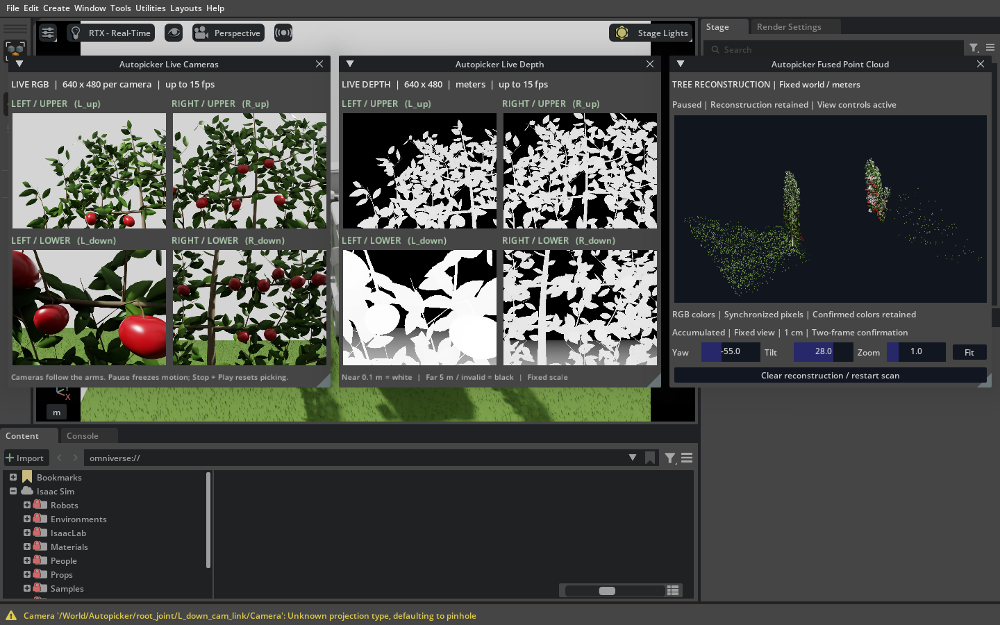
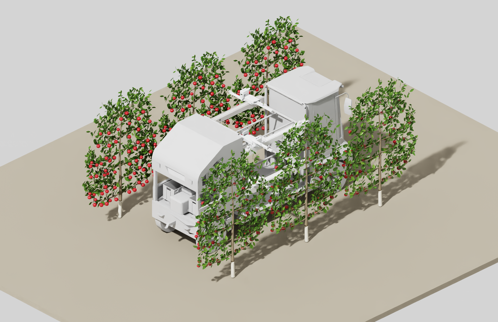

# autopicker-diffusion-policy

基于 **NVIDIA Isaac Sim 5.1** 的四机械臂苹果采摘仿真项目，包含双侧二维果墙、自动采摘、RGB-D 相机、彩色点云配准与果树表面累积重建。

当前版本提供仿真场景和基于几何规划的控制基线，研究分支另含低维 Diffusion Policy 训练与仿真评估入口。

Diffusion Policy 研究在 `research/diffusion-policy` 分支开展：支持单臂示范采集、RGB-D 锁步录制、Zarr 数据转换、官方 U-Net 适配训练、checkpoint 重载及独立进程策略推理，操作见[研究工具说明](research/README.md)。研究路线与接口草案分别见[研究方案](docs/research/2026-11-22-diffusion-policy.md)和[数据契约](docs/research/autopicker-dataset-contract.md)。当前实验使用真值低维输入；纯策略结果见 [M5 报告](docs/research/2026-11-23-m5-validation.md)。新增精抓接管与抓取事件门控的混合模式：三个已见目标抓取 3/3、放果 2/3，留出目标仍为 0/2；它使用传统 IK，不能算作纯扩散策略成功，详见 [M6 报告](docs/research/2026-11-23-m6-validation.md)。



## 功能说明

| 模块 | 已实现功能 |
| --- | --- |
| 果园场景 | 四臂 Autopicker、两侧平面树型果墙、6 棵树、396 个独立苹果、草地及碰撞设置；场景单位为米，Z 轴朝上 |
| 场景布局 | 两侧树冠内缘净距约 2.9 m，固定机身到每侧树冠净距约 0.687 m |
| 自动采摘 | 四臂独立选取可达苹果，沿相对水平面向上倾斜 30° 的路径接近、采摘、回收和放果；完成后继续下一颗 |
| 接果装置 | 四个边长 15 cm 的接果立方体，仅沿对应机械臂 `hor` 方向随动，放果时位于末端下方；已收集苹果隐藏 |
| 抓偏与落果 | 可配置定位偏差；接触苹果或枝干后触发树体衰减摆动，附近果实脱落并通过 PhysX 刚体落到地面 |
| 四路 RGB-D | 原 `cam_link` 外壳内安装四台相机，随机械臂运动；每路输出 640×480 RGB 和米制光轴深度，分别显示四宫格 |
| 同步配准 | 同一 Writer 批次读取四路 RGB、深度、渲染相机参数及时间戳，将有效深度点转换到固定世界坐标系 |
| 彩色重建 | 点颜色来自对应相机同帧、同像素 RGB；1 cm 体素、两个不同渲染时刻确认，已确认点的位置与颜色固定，新区域逐渐补充 |
| 点云交互 | 固定初始观察范围，支持 Yaw / Tilt / Zoom、Fit 和 Clear；暂停保留重建，Stop 清空后可重新扫描 |
| 模块化运行 | USD 只保存场景，Python 管理控制与相机；统一启动、源码重新加载、重复实例替换、停止重启及关闭清理 |
| 单文件演示 | 打包器将当前程序嵌入另一个 USD，方便分享；生成过程不修改开发版场景 |
| 研究数据工具 | R_down 单臂专家示范、480 Hz 状态/动作、10 Hz 锁步 RGB-D、限位执行器、命令重采样回放与数据审计 |



[查看振动与落果视频](outputs/autopicker_shake_drop_preview.mp4)。该视频来自此前版本的落果演示，演示偏差频率与当前默认参数不同。

## 文件结构

```text
outputs/
  autopicker_apple_orchard.usd          开发版场景，不含控制脚本
  autopicker_start.py                  统一启动入口
  autopicker_runtime.py                启停、重启与资源清理
  autopicker_apple_pick.py              采摘、接果、振动与落果
  autopicker_camera_viewer.py           RGB、深度及点云窗口
  autopicker_depth_fusion.py            RGB-D 配准与增量地图
  autopicker_package.py                单文件演示版打包
  autopicker_apple_使用说明.md           详细使用说明、参数与接口
  autopicker_apple_validation.json      场景及运行验证记录
  dist/
    autopicker_apple_orchard_demo.usd   可直接 Open → Play 的演示版
work/
  autopicker_fusion/test_fusion.py           配准几何测试
  autopicker_reconstruction/test_reconstruction.py  累积重建测试
  autopicker_rgb_cloud/test_rgb_cloud.py     RGB 点云测试
  autopicker_rgbd/test_depth.py              深度显示测试
  autopicker_modules/                       模块结构与生命周期测试
research/
  README.md                                采集、训练与闭环评估说明
  autopicker_dp/                            任务环境、Dataset、策略、训练及推理入口
  requirements-training.txt                独立训练环境依赖
  tests/                                   数据/控制/训练检查与仿真产物验收
```

两个 USD 均包含自身所需的模型和材质，无外部 USD 或贴图依赖。开发运行需要保留 `outputs` 中的场景及全部 Python 文件；单文件演示仅需复制 `outputs/dist/autopicker_apple_orchard_demo.usd`。

## 环境要求

- NVIDIA Isaac Sim **5.1** 及其支持的 NVIDIA RTX GPU、驱动与操作系统。
- 仿真使用 Isaac Sim 自带的 Python、PhysX、OpenUSD、NumPy、SciPy、Replicator 和 UI 扩展。
- 普通 USD 查看器只能查看静态场景；普通系统 Python 不能直接运行仿真。
- 本机 RTX 4060 Laptop 8 GB 的历史测量中，三窗口同时显示、启用 RGB 点云时约为 7.6 Hz；15 Hz 是显示更新上限，实际速度取决于硬件和场景负载。

## 快速启动

```bash
git clone https://github.com/wangxj2014/autopicker-diffusion-policy.git
cd autopicker-diffusion-policy
```

### 方式一：在 Isaac Sim 内启动开发版

打开 Isaac Sim 5.1 的 Script Editor，修改以下绝对路径为你的仓库路径并运行：

```python
import runpy
runpy.run_path('/absolute/path/autopicker-diffusion-policy/outputs/autopicker_start.py', run_name='__main__')
```

Windows 路径可写成 `r'C:\projects\autopicker-diffusion-policy\outputs\autopicker_start.py'`。

入口自动打开开发版 USD，启动四臂采摘，并打开 **Autopicker Live Cameras**、**Autopicker Live Depth** 和 **Autopicker Fused Point Cloud** 三个窗口。仅打开开发版 USD 再点击 Play 不会启动采摘程序。

### 方式二：使用 Isaac Sim 的 Python

在仓库根目录执行，先将安装路径换成自己的路径。

Linux：

```bash
/path/to/isaac-sim/python.sh outputs/autopicker_start.py
```

Windows PowerShell：

```powershell
& 'C:\isaacsim\python.bat' '.\outputs\autopicker_start.py'
```

可选参数：`--headless` 无窗口运行，`--scene /path/to/scene.usd` 指定开发版场景，`--frames 90` 运行有限更新次数以检查启动。

### 方式三：播放单文件演示版

1. File → Open 打开 `outputs/dist/autopicker_apple_orchard_demo.usd`。
2. 启用 `omni.graph.scriptnode` 扩展；如提示执行场景中的 Script Node，允许本次运行。
3. 点击 Play，自动开始采摘并显示相机和重建窗口。

演示版自带程序，不需要运行开发版启动入口。

## 操作与开发

- **Pause → Play**：保留采摘进度和点云，继续运行。
- **Stop → Play**：恢复苹果并重新开始采摘，清空旧点云，复用当前窗口。
- **Clear reconstruction / restart scan**：仅清空地图，采摘继续。
- **修改 Python 后**：重新运行 `autopicker_start.py`，关闭旧实例并读取磁盘上的最新源码。单纯 Stop → Play 不会重新加载源码。
- **修改 USD 后**：重新打开场景，再运行统一入口；从旧内嵌版迁移时也需先重新打开开发版 USD。
- **关闭场景后**：控制和相机资源释放；再次运行时重新执行统一入口。

控制默认值位于 `autopicker_apple_pick.py` 的 `DEFAULTS`。例如关闭人为抓偏演示：

```python
import runpy
entry = runpy.run_path('/absolute/path/autopicker-diffusion-policy/outputs/autopicker_start.py')
task = entry['launch'](config={'grasp_error_every': 0})
```

读取当前图像与重建数据：

```python
import builtins
viewer = builtins.autopicker_camera_viewer
frame = viewer.get_depth_frame('L_up')
cloud = viewer.get_point_cloud()
if frame is not None and cloud is not None:
    rgb = frame['rgb']                      # 480 × 640 × 3，uint8 RGB
    depth_m = frame['depth_m']              # 480 × 640，float32 米
    points_world_m = cloud['points_world_m']  # N × 3，float32 米
    colors_rgb = cloud['colors_rgb']        # N × 3，uint8 RGB
```

接口返回独立副本；初始化、Clear 或 Stop 后可能为 `None`。`get_live_point_cloud()` 可读取未经累积的最新四路点云。

## 重新生成单文件演示版

使用 Isaac Sim 自带 Python 运行：

```bash
/path/to/isaac-sim/python.sh outputs/autopicker_package.py
```

默认输入为开发版场景和同目录 Python 文件，输出为 `outputs/dist/autopicker_apple_orchard_demo.usd`。修改源码后需重新打包才会更新演示版。打包器只接受资源自包含的场景，遇到外部层或贴图会报错。

## 验证

23 项 RGB、深度、几何配准与重建测试可在安装 NumPy 的 Python 环境中运行：

```bash
python work/autopicker_fusion/test_fusion.py
python work/autopicker_reconstruction/test_reconstruction.py
python work/autopicker_rgb_cloud/test_rgb_cloud.py
python work/autopicker_rgbd/test_depth.py
```

模块结构与打包检查需要 OpenUSD。可在独立的测试 Python 环境中安装 NumPy 和 `usd-core`，无需启动仿真：

```bash
python -m pip install numpy usd-core
python work/autopicker_modules/test_layout.py
```

生命周期测试需要通过 Isaac Sim 自带 Python 启动完整仿真：

```bash
/path/to/isaac-sim/python.sh work/autopicker_modules/test_lifecycle.py
```

历史模型对比检查只用于本地迁移验收；仓库不包含旧 USD 备份，新克隆会跳过该项。当前开发版与演示版均已实测完成 12 次收果和 1 颗接触落果，验证四路 RGB、四路深度、RGB 点云累积、Stop/Play、重复启动和关闭清理。详细结果见[验证记录](outputs/autopicker_apple_validation.json)。

## 当前范围

- 采摘采用几何规划和到位检测，没有学习策略、RGB 识别选果或真实抓手接触求解；成功抓取采用视觉吸附方式。
- 当前工位不是所有 396 颗苹果都可达。机器人不会自动换工位，某臂完成可达目标后停止，其他臂继续。
- 点云只重建相机观察到的表面；当前没有未知表面补全或语义动态物体剔除，已确认的苹果点在果实采走后仍保留，可点击 Clear 重扫。
- 树体振动为衰减动画与几何接触近似；未建立枝条柔性动力学或果柄断裂模型。

完整参数、坐标约定与操作细节见[中文使用说明](outputs/autopicker_apple_使用说明.md)。
