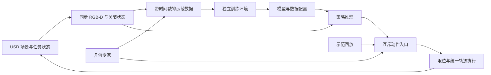

# Diffusion Policy 应用于 Autopicker 的初步研究

日期：2026-11-22。研究分支：`research/diffusion-policy`。

项目基线：`44f6d3685bfa94d0e14e25712c3273bb0b094455`。本文保留初始研究方案，实验参数和验收目标不等于已取得的结果。后续已增加独立的 M0 采集与回放工具，实际实现范围与命令见[研究工具说明](../../research/README.md)；下文的训练网络和学习评估仍是规划。

## 1. 建议路线

先选 **R_down 单臂、固定机身、指定一颗可达苹果**，学习“接近 → 采摘 → 回收 → 放果”的四维关节目标序列。现有几何控制器提供专家示范；环境负责目标分配、视觉吸附、接果计数及失败判定。先通过示范回放，再依次验证低维状态 Diffusion Policy、RGB 条件策略和实时点云 DP3，最后扩展四臂。

选择 R_down 的原因是已有验证记录中该臂有 18 个可达目标，比其他单臂有更多目标位置可用于划分实验。这个数量需要在采集启动时重新检查，不能用它替代当前场景的可达性验证。

最终研究问题是：在相同目标、示范和执行器条件下，学习策略是否能保持采摘成功率，并对初始关节扰动、感知误差、遮挡和新目标位置更稳健。仅拟合现有轨迹或降低训练 loss 不能回答这一问题。

| 路线 | 输入与优点 | 需要解决的问题 | 定位 |
| --- | --- | --- | --- |
| 低维 Diffusion Policy | 关节状态、苹果真值位置、接果位置；计算量较小，便于发现接口问题 | 使用仿真真值，不能证明视觉能力 | 首个学习实验 |
| RGB Diffusion Policy | 当前臂 RGB、关节状态、明确的目标条件；可复用官方图像策略 | 需要目标可见性、时间对齐及目标条件；可能忽略图像而依赖真值 | 第一条视觉基线 |
| 点云 DP3 | 当前 RGB-D 生成的局部点云、关节状态、目标条件；适合空间位置变化 | 动态点云、点采样、坐标统一、遮挡和资源开销 | RGB 基线之后对照实验 |

现有确定性控制器本身就是重要基线。Diffusion Policy 的价值需要通过相同条件的闭环比较验证，不能预设它一定优于几何规划。

## 2. 当前项目能复用什么

下表描述研究开始时的资产基线；M0 通过独立研究包补充采集、重置和回放，原演示模块继续保留原职责。

| 当前代码或资产 | 已有能力 | 研究接入缺口 |
| --- | --- | --- |
| [开发版 USD](../../outputs/autopicker_apple_orchard.usd) | 双侧果墙、独立苹果、四臂机器人、原 cam_link 外壳和相机 | 场景不是可随机重置的训练环境；种子不等于生成了新果园 |
| [采摘控制器](../../outputs/autopicker_apple_pick.py) | 按关节名称映射、FK/IK、30° 向上接近、回收放果、抓偏和落果 | 没有单回合采集器、策略动作接口或完整轨迹数据 |
| [RGB-D 查看器](../../outputs/autopicker_camera_viewer.py) | 四路同批 RGB、光轴深度、渲染相机参数和时间戳 | 图像尚未与关节状态对齐；UI 更新频率不等于训练控制频率 |
| [深度配准](../../outputs/autopicker_depth_fusion.py) | 当前帧世界点云、RGB 颜色、固定体素重建 | 累积地图保留已摘苹果的旧点，不能直接作为实时物体状态 |
| [运行管理](../../outputs/autopicker_runtime.py) | 重启、停止、暂停、关闭清理 | 需增加专家、回放、策略模式的互斥控制权 |
| [验证记录](../../outputs/autopicker_apple_validation.json) | 历史可达性和控制运行结果 | 不是学习策略的闭环评估，也不是密集示范数据集 |

必须保持以下事实和接口约束：

- 每臂是 `roll / hor / ver / rot` 四个自由度，顺序为旋转、平移、平移、旋转；单位分别为 rad、m、m、rad。不是通用七轴机械臂，也没有现成的夹爪开合动作。
- 现有 `records` 记录成功抓到苹果的事件，缺少连续的观察、动作与时间序列，不能直接送入训练。
- 当前成功抓取采用视觉吸附。学习策略即使完成仿真任务，也不能证明真实抓手接触、果柄断裂或真实苹果采摘可行。
- 默认每四次尝试注入一次抓偏；干净示范必须显式设置 `grasp_error_every=0`。抓偏、树振动和落果作为后续独立鲁棒性测试。
- 控制器每个物理步写位置与速度目标。策略加入后必须成为唯一写入者，否则两个控制器会覆盖彼此的动作。
- 原控制器臂顺序与相机显示顺序不同，按名字映射，不能直接按数组序号配对。
- 当前机身固定，396 颗苹果不全可达；此前记录为 40 颗可达苹果。完整果园采收还需要换工位和任务分配研究。

## 3. Diffusion Policy 如何接入

原始 Diffusion Policy 将示范中的动作序列建模为条件去噪过程：读取一段观察历史，生成一段动作，仅执行前面一小段，再用新观察重新预测。这不是只输入苹果坐标并直接输出一个抓取点。

官方实现已经分开 `Dataset`、`Policy`、`EnvRunner` 和 `Workspace`。本项目宜新增 Autopicker 数据适配器与运行适配器，复用上游模型和训练框架，不把网络、训练程序或模型权重嵌进 USD。

图中的采集和回放已进入 M0 实现；训练、checkpoint 和策略推理仍待 M1/M2 实现。

### 3.1 控制职责

拟提供 `expert / replay / policy` 三种模式。同一时刻只允许一种模式输出所选机械臂的目标，其余三臂保持在记录的初始位置。模式、场景和回合切换都清空旧观察和未执行动作。

环境可以保留苹果分配、触发吸附、接果跟随、隐藏已收果实和碰撞/超时判断。策略需要决定接近和返回过程的运动。`policy` 模式不能再调用专家 IK 轨迹来纠正策略路径，否则评估的实际仍是专家。抓取和放果判断使用实际末端与任务状态，而不是模型预测或专家预定到达时间。

现有事件判断嵌在 `step()` 的阶段切换内，因此不是“替换一个目标数组”就能完成接入；需先把动作生成和任务事件判断分开。保留原专家模式作为回归对照。

### 3.2 第一版动作与节拍

建议预测单臂四维**绝对关节位置目标**。动作值分别按关节单位归一化，反归一化后通过统一执行器限位、限速、限加速度，再写入 PhysX。专家的当前命令、实际关节位置和未来目标必须区分，详见[数据契约](autopicker-dataset-contract.md)。

首轮候选参数如下，只有回放验收通过后才冻结到数据集版本：

| 参数 | 初值 | 原因与约束 |
| --- | --- | --- |
| 物理步长 | 1/480 s | 与当前控制器一致 |
| 数据/动作间隔 | 0.1 s，即 10 Hz 仿真时间 | 每个动作间隔 48 个物理步；不是要求 UI 每秒刷新十次 |
| `n_obs_steps` | 2 | 两个连续观察时刻 |
| `horizon` | 16 | 采用上游序列索引约定，包含与观察历史对齐的动作槽 |
| `n_action_steps` | 2 | 每次只执行 0.2 s 的动作，再重新观察与规划 |
| 动作维数 | 4 | 单臂关节目标，无虚构的 gripper 通道 |
| 采集速度 | 单独使用 `speed_scale=1` 起步 | 默认演示仍为 45；先保证最短接近段有足够采样，再测量提速 |
| 图像输入 | 当前臂 RGB，先缩小到 160×120 | 原始 640×480 可另存；不先接入四幅全分辨率图像 |

官方图像配置为 `horizon=16 / n_obs_steps=2 / n_action_steps=8`，上表将执行段缩短到 2，是本项目的实验选择。代码取预测序列 `[n_obs_steps-1 : n_obs_steps-1+n_action_steps]`，不能把整个 16 步输出从索引 0 开始执行。

当前加速演示中一些接近段很短，直接以 10 Hz 抽帧可能丢失关键过程。若回放不能达到原有毫米级接近要求，先提高到 20 Hz（每 24 个物理步）或延长采集动作，再重新采集；不能通过放宽吸附容差掩盖问题。

### 3.3 视觉与深度

首轮低维策略使用苹果真值坐标，明确命名为 `oracle_lowdim`。它只验证数据和闭环控制，不作为视觉策略成果。

RGB 阶段分两步：先在同样真值条件下增加 RGB 并做遮黑图像消融，检查网络是否使用图像；再用目标像素/目标掩码条件替代真值三维坐标。果墙上有多个苹果，只给一张 RGB 不能明确“这次摘哪一颗”。目标检测/分割当前尚未实现；使用仿真目标掩码也必须标记为 oracle mask，不能声称实现了真实视觉选果。

DP3 阶段使用当前同步帧点云，变换到机器人基座坐标，裁剪工作空间并固定采样点数，例如先比较 512 和 1024 点。优先验证 XYZ，再做 XYZRGB 对照。官方固定版本的 `dp3.yaml` 为 `use_pc_color: false`、`in_channels: 3`；本项目已有 RGB 彩色点云，并不意味着原版 DP3 会自动消费颜色。

点云采用 `get_live_point_cloud()` 对应的最新批次，不能直接使用 `get_point_cloud()` 的固定历史地图。必须记录无效深度、空点云和目标被遮挡的情况；不能用旧苹果点补成“当前看到的苹果”。

## 4. 数据与评估设计

一个 episode 从“复位完成、目标分配、初始帧有效”开始，到“指定苹果已放入接果装置”或明确失败结束。抓到苹果并不等于 episode 成功。成功还需要采摘与放果事件对应同一颗苹果、接果计数增加、果实最终被收集。

首批干净示范只收成功回合用于行为克隆，失败回合单独保存原因，作为诊断和后续恢复策略数据。所有采集尝试都要计数，不能用过滤后的成功示范比例冒充在线成功率。

建议首轮数据量为 200 个训练回合、40 个验证回合、60 个最终测试回合，属于起步预算，不是保证足够的数据规模。若 R_down 的 18 个目标均通过新验收，可按目标身份固定划分 12/3/3 个目标，再在各自集合里变化有效的初始关节状态。必须先划分目标组再生成轨迹；同一轨迹的相邻帧、复制数据或仅改变光照的同目标回合不能跨组泄漏。

这只能评估同一果园内未参与训练的目标位置。要声称跨树、跨场景泛化，需另建并验证具有不同几何布局的场景，再按场景划分。更换随机种子不会自动改变现有 USD。

| 实验 | 变化 | 核心比较 |
| --- | --- | --- |
| E0 专家与回放 | 原专家、经过共同执行器的重采样回放 | 采样与执行接口本身是否损失成功率 |
| E1 低维 | 真值目标 + 关节状态的 Diffusion Policy | 在相同执行器、时间预算下对比专家及简单确定性行为克隆 |
| E2 RGB | 加 RGB、遮黑 RGB、移除三维真值改用目标像素/掩码 | 是否真正使用视觉；oracle 条件逐项披露 |
| E3 点云 | 当前 XYZ、XYZRGB；512/1024 点 | 与 RGB 使用相同数据划分和任务预算，比较遮挡和扰动表现 |
| E4 鲁棒性 | 受控目标定位偏差、初态变化、遮挡、树振动 | 逐项改变扰动，记录原始策略失败与恢复过程 |
| E5 多臂 | 分臂策略到共享权重，再到四臂同时执行 | 跨臂坐标/关节方向映射、资源争用、目标分配和碰撞 |

每个策略至少用三个训练种子报告均值、离散程度及每个目标的结果。60 个测试回合覆盖所有测试目标，记录预先固定的 reset 参数和策略采样种子；不要用测试成功率挑模型。

报告指标包括：完整收果成功率及分母、抓取成功率、末端误差、30° 接近方向误差、意外落果数、接触/碰撞记录、超时、动作限幅次数、单果仿真耗时、实际墙钟耗时、采集同步误差以及推理延迟 p50/p95。当前接触近似与真实接触力不同，需注明指标来源。

## 5. 环境与计算预算

Isaac Sim 继续使用自身 Python。训练使用独立环境、固定上游提交和依赖版本；部署时由独立推理进程交换带时间戳的观察与动作序列，Isaac 端只做执行与任务管理。第一版先用锁步仿真等待推理返回，跑通正确性；随后评估不暂停仿真的实时执行。

官方 Diffusion Policy 环境文件固定了 Python 3.9、PyTorch 1.12.1、CUDA Toolkit 11.6、diffusers 0.11.1、Zarr 2.12.0 等历史版本。这些是上游复现配置，不代表已验证适配本机 GPU、驱动或 Isaac Sim。不要直接安装进 Isaac Python；新环境需先检查 GPU 可用性、序列训练和 checkpoint 保存/加载。

本机历史记录为 RTX 4060 Laptop 8 GB。DP3 官方 README 报告其标准训练约使用 10 GB 显存，该硬件/配置结果不能套用本机。第一轮离线训练时退出仿真，先用较小 batch 和网络配置测峰值显存；推理再与 Isaac 同时测量。候选缩小设置可从 batch 8、U-Net `down_dims=[128,256,512]` 开始，变化必须写入实验配置。

不要把官方 DDPM 的 100 次推理直接称为实时。先确认训练采样器，再独立比较兼容的 DDIM 10/20 步与参考采样设置，报告成功率和延迟。策略重规划间隔暂定 0.2 s；能否稳定在这个预算内完成，需要连同图像传输、编码、采样、回传和 Isaac 渲染一起实测。

640×480 单相机未压缩 RGB+float32 深度每帧约 2.15 MB；10 Hz、20 s、300 回合约 129 GB，不含其他数据。M0 使用 160×120 及压缩 NPZ，规模扩大前根据实际占用决定采集预算；不上传数据集和权重到普通 Git。研究分支保存代码、文档和小型验收报告。

## 6. 分阶段推进与验收

- [x] 创建研究分支，检查当前控制、相机和点云接口。
- [x] 核对官方 Diffusion Policy / DP3 代码、记录版本并比较路线。
- [x] 明确观察、动作、时间戳、数据划分和评估契约。
- [x] M0：实现单臂录制、确定性 reset、统一执行器和回放。已录制 10 个成功回合，覆盖 5 个目标，10 个回合均完成同目标回放收果；完整数据审计通过，保留 3 mm/1° 判据。见[实测验收报告](2026-11-23-m0-validation.md)。
- [ ] M1：建立训练适配器，先对 10 个回合做小数据拟合与 checkpoint 重载，再运行冻结划分的 `oracle_lowdim`。用 rollout 结果判断是否进入视觉阶段，不能只凭训练 loss。
- [ ] M2：补充 RGB 观察及目标条件，完成真值/图像消融，再评估当前帧点云 DP3。先测显存和延迟，再扩大图像数和点数。
- [ ] M3：扩展至其他三臂，验证每臂关节方向、相机对应和工作空间；单臂通过后才并行运行，加入目标互斥与碰撞约束。

M0 已按独立研究包 `research/autopicker_dp/` 推进：`environment.py` 负责 reset/任务事件，`control.py` 负责动作执行，`episode.py` 负责原始记录和审计，`capture.py` 负责锁步 RGB-D，`run.py` 提供命令入口。训练 Dataset、Zarr 转换和网络尚未实现，没有可运行的训练命令。

## 7. 已核对的官方资料

以下资料于 2026-11-22 查询。仓库使用查询时的提交 SHA 固定引用，第三方 README 中的安装和运行命令是参考资料，不是本项目已执行的步骤。

| 来源 | 依据 |
| --- | --- |
| [Diffusion Policy 项目与论文](https://diffusion-policy.cs.columbia.edu/) / [RSS 2023 论文](https://arxiv.org/abs/2303.04137v4) | 条件动作扩散、观察历史、动作序列与滚动执行 |
| [Diffusion Policy 官方仓库](https://github.com/real-stanford/diffusion_policy/tree/5ba07ac6661db573af695b419a7947ecb704690f) | Dataset / Policy / EnvRunner / Workspace 的分工 |
| [官方图像策略配置](https://github.com/real-stanford/diffusion_policy/blob/5ba07ac6661db573af695b419a7947ecb704690f/diffusion_policy/config/train_diffusion_unet_hybrid_workspace.yaml) | 16/2/8 时域、100 个扩散训练时刻和默认推理设置 |
| [官方图像策略代码](https://github.com/real-stanford/diffusion_policy/blob/5ba07ac6661db573af695b419a7947ecb704690f/diffusion_policy/policy/diffusion_unet_hybrid_image_policy.py) / [图像数据适配器](https://github.com/real-stanford/diffusion_policy/blob/5ba07ac6661db573af695b419a7947ecb704690f/diffusion_policy/dataset/pusht_image_dataset.py) | 动作从 `n_obs_steps-1` 开始截取；图像转为通道在前；序列采样与归一化适配 |
| [官方环境文件](https://github.com/real-stanford/diffusion_policy/blob/5ba07ac6661db573af695b419a7947ecb704690f/conda_environment.yaml) | 上游历史依赖版本，不直接覆盖 Isaac 环境 |
| [DP3 官方仓库](https://github.com/YanjieZe/3D-Diffusion-Policy/tree/47385d9d6f5bde3f2ebdf2400ecb8261cc9e6b97) / [论文](https://arxiv.org/abs/2403.03954) | 点云条件策略、示范格式、裁剪与采样、官方训练资源说明 |
| [DP3 配置](https://github.com/YanjieZe/3D-Diffusion-Policy/blob/47385d9d6f5bde3f2ebdf2400ecb8261cc9e6b97/3D-Diffusion-Policy/diffusion_policy_3d/config/dp3.yaml) | 默认不使用 RGB 点颜色、三维点输入、DDIM 与 10 步推理 |
