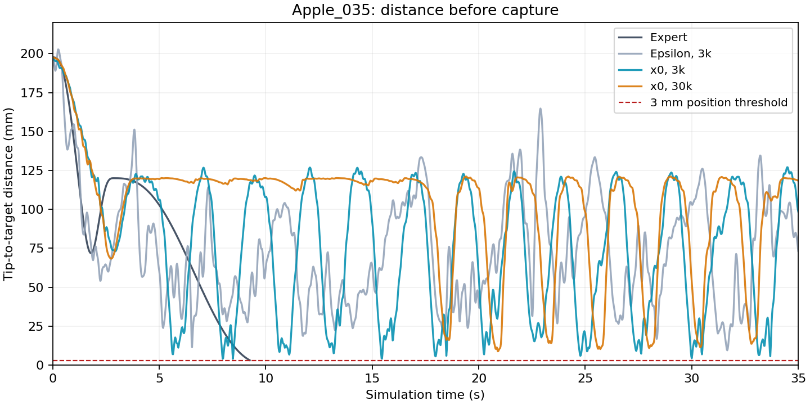

# M5：干净动作预测与训练预算诊断

本轮没有提高完整采摘成功率。3000 步同预算模型与额外 30000 步模型都得到已见目标 0/3、验证目标 0/2，十次新试验均未触发抓取。干净动作预测明显降低了专家观测下的动作误差和采样波动，但不足以保证闭环抓取。下一步应检验反复接近后退开的控制行为及抓取事件切换，不能将离线精度当作成功率提升。

## 改动与比较条件

网络增加 `prediction_type`：默认 `epsilon` 预测扩散噪声；`sample` 预测干净的归一化动作序列，训练目标与 DDIM 解码同时切换。旧 checkpoint 缺少此字段时仍按 epsilon 解释；保存的 scheduler 与模型目标不一致时拒绝加载。

基线复用 M3，未采用表现较差的 M4 动态恢复训练集。两组均使用主 train 的 820 个窗口与 M2 静态恢复的 685 个窗口，共 1505 个，均匀抽样，恢复窗口占 45.51%；完整 normalizer 固定为主 train 拟合结果，动作使用物理关节上下限。seed=0、batch=64、AdamW lr=1e-4、EMA 上限 .995、U-Net 64/128/256、100 步 cosine 与 DDIM20 均相同。

闭环使用 train 索引 `[1,2,4]` 与 val `[0,5]`，依次为 Apple_035、026、034 和重复两次的 Apple_036。抓取位置 3 mm、方向 1°、收果距离 25 mm、超时 35 s 保持不变。策略动作不调用专家 IK；重置和接果装置初始化仍使用既有环境模型。没有增加 test 闭环。

M3 到 M5 的源码散列还包含 M4 期间 `augmentation.py`/`rollout.py` 的动态来源验证、状态恢复分支和新增 `dynamic_recovery.py`。本轮使用静态恢复数据与普通重置，不启用这些分支。不能据此声称整个仓库只变了两个文件。3000 与 30000 步 sample 实验的既有源码必须逐项相同；只允许较长训练新增未被训练或推理调用的离线诊断文件 `diagnose.py`。

## 闭环实测

| 条件 | 已见目标 capture / collect | 验证 capture / collect | 已见目标最近距离（mm） | 验证最近距离（mm） |
| --- | --- | --- | --- | --- |
| M3 epsilon，3000 步 | 0/3 · 0/3 | 0/2 · 0/2 | 9.415 / 12.917 / 7.811 | 97.082 / 81.140 |
| M5 sample，3000 步 | 0/3 · 0/3 | 0/2 · 0/2 | 3.579 / 4.143 / 10.835 | 116.918 / 118.568 |
| M5 sample，30000 步（额外预算） | 0/3 · 0/3 | 0/2 · 0/2 | 8.724 / 7.852 / 20.683 | 85.804 / 85.102 |

最近距离取未附着阶段真实末端到目标的距离，不是抓取判定；抓取还要求方向和真实事件。3000 步 sample 相比 M3，前两个已见目标更接近，第三个及验证目标退步。同预算的全部五次新试验均以 35 s 超时结束，没有挑选或删除失败。M5 train/val 的推理 p95 约 114.7/116.0 ms；仿真等待推理时不推进物理时间，不能据此声称真机实时控制已通过。

固定专家观测诊断使用原 train 每八个窗口抽一个，共 103 个窗口、206 个有效动作节点，分别以噪声种子 0–7 推理。种子标准差刻画相同观测下的采样波动，平均预测偏差与单次采样误差单独计算，排除 padding：

| 模型 | hor 种子标准差（mm） | ver 种子标准差（mm） | hor 平均预测偏差（mm） | ver 平均预测偏差（mm） |
| --- | ---: | ---: | ---: | ---: |
| M3 epsilon 3000 | 9.086 | 7.613 | 3.888 | 3.359 |
| M5 sample 3000 | 0.0558 | 0.0255 | 1.380 | 0.551 |
| M5 sample 30000（额外预算） | 0.0130 | 0.0055 | 0.121 | 0.080 |

完整 parent-train 离线 MAE（关节顺序 roll / hor / ver / rot，单位 rad / m / m / rad）从 `[.015278, .007422, .006257, .030829]` 降到 `[.001687, .001380, .000563, .004540]`。M5 val 为 `[.085417, .082757, .015603, .067001]`，test 为 `[.229492, .123455, .074616, .243398]`，并非全面改善。所有离线输出均在关节限位内。这些统计是在专家观测下计算，不能推断策略自身闭环状态上的波动也这么低。

## 额外训练预算

3000 步未能完成已见目标采摘，且仍有毫米级残余动作误差，因此执行计划中的唯一一组 30000 步诊断。重新从相同 seed 开始，数据、网络、执行器与门槛相同，只评估最终 EMA，不搜索中途 checkpoint、推理种子或阈值。这组增加了训练预算，须单独解读，不能归入同预算的 epsilon/x0 目标消融。

没有启用 CUDA 严格确定性：两次 sample 训练的前 3000 步损失并非逐位相同。这是相同配置下的重训，不是从已保存 3000 步模型无缝续训。该对照只能提供单次开发诊断，不能隔离所有随机数值差异。

30000 步模型训练耗时约 501 s（3000 步约 49 s），重载误差为零。完整 train 离线 MAE 为 `[.000197, .000119, .000073, .000490]`，val 为 `[.060486, .077882, .017946, .040812]`，test 为 `[.270600, .131873, .061686, .214161]`。专家观测下已见目标精度进一步改善，验证/test 仍有明显误差，不能声称泛化改善。其三次已见目标最近距离全部比 3000 步 sample 模型更差；验证最近距离比 3000 步 sample 更小，但仍未抓取。较长模型 train/val 推理 p95 为 118.1/122.3 ms。



上图由原始 480 Hz 轨迹每十步抽样绘制，距离统计仍使用所有原始步。专家约 9.26 s 触发 capture；三条策略轨迹均没有 capture，反复接近后又远离目标。x0 让轨迹更平滑，但未形成稳定的抓取行为。需要进一步检验抓取前后的动作预测、执行器跟踪状态与事件切换之间的关系；这张距离图本身不能确定根因，也不支持继续盲目增加训练步数。

## 验证与边界

73 项单元测试通过，包括 x0 loss 的标签、padding 掩码与梯度，固定已知 x0 的 DDIM 推理，目标配置保存/加载，旧模型回退，目标不一致拒绝，以及诊断和实验预算/数据/源码篡改拒绝。独立审查还将真实 M3 checkpoint 在旧/新实现上的三个观测、三个种子输出逐位比较，结果一致。

两组完整产物已通过 `AUTOPICKER_M5_AUDIT_PASS`，核对数据散列、checkpoint、normalizer、训练配置、诊断探针、重置、阈值、源回合、请求时序及全部尝试。新增十次策略试验，复用五次 M3 基线试验；两种预算分开统计，全部十次新试验均在 35 s 超时，capture/collect 均为零。完整机器可读结果见[JSON 报告](2026-11-23-m5-validation.json)，命令见[研究 README](../../research/README.md)。epsilon 与 sample 的 loss 定义不同，不能用两者的绝对 loss 大小宣称提升。

当前仍是固定场景、R_down 单臂、真值低维输入、一个训练种子和视觉吸附。验证回合来自同一留出目标，不是两个独立场景；test 离线结果已用于持续开发诊断，不能充当最终未触碰测试集。本轮不证明多果连续采摘、视觉策略、真实接触动力学或泛化。原始数据、权重与日志保留本地，Git 只保存代码、说明及小型验收报告。

## 本地模型与复核入口

| 模型 | checkpoint SHA256 |
| --- | --- |
| M3 epsilon 3000 | `b72e353b8c6f315402c348f4f2230fb785edb2d2bee0772c30ea5e398434800c` |
| M5 sample 3000 | `5fe37bb957b8175e5feb6539863831973df5299b7f2af4d406db1fe5bb2f0375` |
| M5 sample 30000 | `d0d90421470e49ac5c3828e5486ade87da326907a33f994d725b5fc18d47f85a` |

最终汇总为同目录 `2026-11-23-m5-validation.json`；拥有本地数据与权重时运行：

```bash
work/autopicker_train_env/bin/python research/tests/validate_m5.py --include-longer --output work/m5-recheck.json
```
