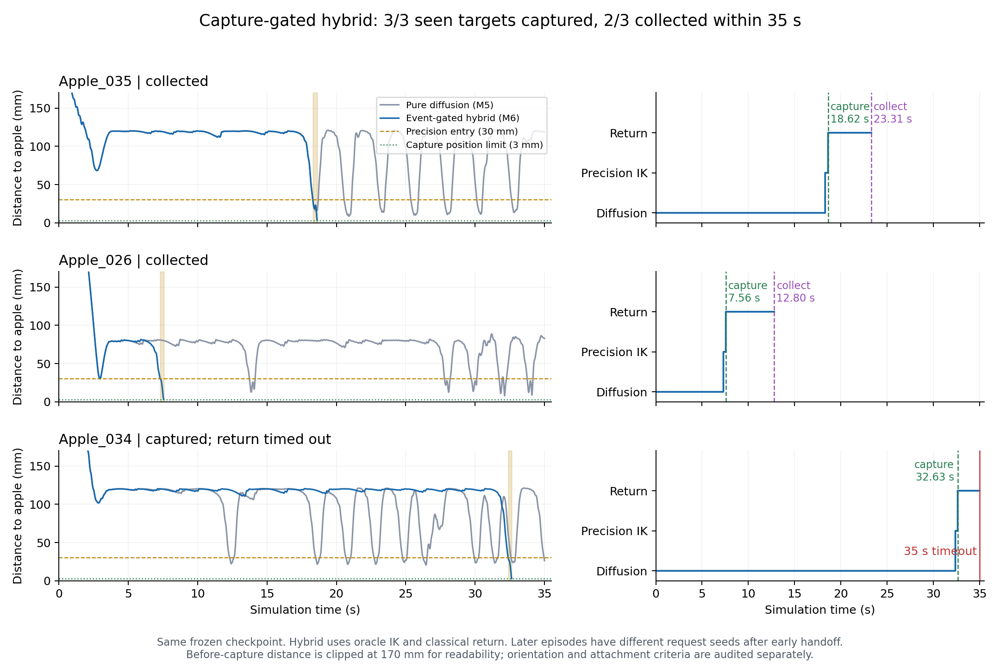

# M6：抓取事件门控与精抓接管

**混合控制在三个已见目标上抓取 3/3、放果 2/3；冻结的纯扩散策略基线为抓取 0/3、放果 0/3。留出目标仍为 0/2。** 第三个已见目标抓到苹果时已接近时限，回撤途中超时，保留为放果失败。本轮证明了精抓接管与事件回撤在这些状态下可执行，没有证明纯扩散策略学会采摘。

日期：2026-11-23；分支 `research/diffusion-policy`；从 `7bb8a84` 开始开发。五次新增仿真记录当时实际源码散列，代码开发期间未改写既有模型、数据或 M5 日志。展示用 USD、四臂演示和相机保持原版本。

## 排查结论

“接近—退开”的命令在 `attached=false` 时就已由策略输出，环境没有错误触发 capture 或提前进入 return。以 Apple_035 的 18.6 s 请求为例，实测距苹果约 16 mm，下一动作块指向约 68/78 mm 外。多次最近位置仍不满足 1° 姿态要求，因此不能仅用最近距离判定应当抓取。

针对三个固定退开请求，用同 checkpoint、同 request_id 重放得到与日志完全相同的动作。只替换两帧观测中的速度为相近父 train 示范状态的速度，得到以下反事实。匹配使用归一化关节位置、目标位置与相同附着状态；具体选择和完整观测保存在[诊断 JSON](2026-11-23-m6-transition-diagnostic.json)。

| 目标 / 请求时刻 | 原预测两节点距苹果 (mm) | 替换速度后 (mm) |
| --- | ---: | ---: |
| Apple_035 / 18.6 s | 67.980 / 78.220 | 12.418 / 11.863 |
| Apple_026 / 13.8 s | 30.466 / 24.383 | 16.599 / 14.544 |
| Apple_034 / 12.6 s | 101.453 / 105.643 | 21.938 / 20.321 |

三个请求是调查过程中选取的案例，不是独立统计样本。反事实提示网络对闭环速度偏移敏感，但不能排除观测歧义、跨阶段预测和训练覆盖等因素。它也不是一个物理一致的恢复轨迹。专家速度替换只用于离线诊断，从未输入本轮实时控制器。导出的 USD 运动学在抽样状态上与实测末端位置相符，误差小于 0.002 mm。

## 本轮修改

新增独立 `--mode hybrid`，控制顺序为：

1. **粗接近**：冻结的 M5 sample 30000 步扩散策略，每 0.2 s 重规划。
2. **精抓**：实测末端首次进入 30 mm 区域，锁存苹果中心及向上倾斜 30° 的 IK 目标。停止网络调用，通过五次平滑插值和原限速、限加速度执行器到达并保持目标。不会因为插值结束或暂时退离区域而重新运行 pregrasp。
3. **回撤**：只在真实 capture 当帧切换。要求同目标 capture、attached=true 和环境 return 状态同时成立；从当前已施加命令开始新轨迹，hor 目标取当前实测值，回到原接果位置。实际 collect 结束回合。

这是“扩散粗接近 + 真值 IK 精抓 + 传统回撤”的混合方法。传统控制承担终端采摘与放果，不能把结果归为纯学习策略成功。接管保持请求位置连续，原执行器仍限制速度和加速度；惯性可能产生短暂外移，因此不声称距离严格单调。位置阈值仍为 3 mm，姿态阈值仍为 1°，收果范围仍为 25 mm，超时仍为 35 s。模型和训练预算均未改变。

## 闭环结果

三次已见目标使用父 train 索引 `[1,2,4]`，验证使用 `[0,5]`（同一个留出目标重复两次）。新增五次 hybrid，复用五次 M5 纯策略基线；seed=0，重置、场景、控制参数相同。所有仿真顺序运行，测量期间没有其他 GPU 训练或推理。

| 目标 | 精抓接管 (s) | capture (s) | collect (s) | 35 s 内结果 |
| --- | ---: | ---: | ---: | --- |
| Apple_035 / 已见 | 18.304 | 18.619 | 23.306 | 成功 |
| Apple_026 / 已见 | 7.304 | 7.563 | 12.800 | 成功 |
| Apple_034 / 已见 | 32.383 | 32.633 | — | 已抓取，回撤途中超时 |
| Apple_036 / 验证 1 | 未进入 | — | — | 超时，最近 85.804 mm |
| Apple_036 / 验证 2 | 未进入 | — | — | 超时，最近 85.102 mm |

三次精抓从接管到 capture 分别用时 0.315、0.258、0.250 s。capture 实测位置误差分别为 2.779、2.909、2.994 mm，姿态误差为 0.212°、0.077°、0.262°。三个 return 都在 capture 同帧启动，接管后无网络请求；三段传统控制的实际施加位置和速度命令全部可精确重建，最大数值差为 0。

| 范围 | 纯策略抓取 / 放果 | 混合抓取 / 放果 |
| --- | --- | --- |
| 已见目标，3 次 | 0/3 / 0/3 | 3/3 / 2/3 |
| 留出目标，2 次 | 0/2 / 0/2 | 0/2 / 0/2 |



提前停止网络推理减少了 request_id 的消耗，因此后续两个已见回合的扩散噪声序列与原基线不同。这是同权重、同重置、同全局 seed 的端到端系统比较，**不是所有回合逐请求配对的随机数消融**。第一个已见回合在接管前使用相同请求序列；验证集没有接管，两次最近距离与原基线一致。不能将第三个已见回合较晚到达完全归因于混合控制，也没有通过增加时间预算将该失败改记为成功。

## 验证与复现

82 项自动化测试通过，包括精抓锁存、同帧 capture 门控、附着丢失、非法 IK、跨重置复用、伪造事件、提前回撤、跳过推理、修改控制参数和施加命令等拒绝测试。独立复核发现原审计仅信任事件记录中的角度；补充负例后，新增逐行关节 FK 与实测末端位置、抓取姿态、精抓目标和回撤接果目标的独立核验。实际控制代码与仿真产物未改写，无须因审计增强而重新仿真。最终产物审计绑定 checkpoint、源数据、重置、源码、事件/附着及实际轨迹，并完整保留五次尝试。增强审计经独立 CPU 复算通过，输出 JSON 与本报告完全一致。

当前审计器对“首次进入精抓区时 IK 失败、末帧尚未生成 precision 事件”的日志会拒绝阶段审计；运行器仍保存该失败尝试。本轮未发生此类异常；后续应区分终端接管失败与中途漏记接管，避免审计假阴性。

`AUTOPICKER_M6_AUDIT_PASS` 表示产物与协议通过审计，不表示泛化成功。完整机器可读结果见[验收 JSON](2026-11-23-m6-validation.json)，启动命令见[研究说明](../../research/README.md#m6精抓接管与抓取事件门控)。已有本地数据和权重时，可执行：

```bash
work/autopicker_train_env/bin/python research/tests/validate_m6.py --output work/m6-recheck.json
work/autopicker_train_env/bin/python research/diagnostics/m6_capture_transition.py --device cuda --output work/m6-diagnostic-recheck.json
work/autopicker_train_env/bin/python research/diagnostics/m6_plot.py
```

checkpoint SHA256：`d0d90421470e49ac5c3828e5486ade87da326907a33f994d725b5fc18d47f85a`；父数据 SHA256：`f7d96a5015010969051af29532cbc0d2203b0cc852703fb0b5dec0a43c704fd5`。大体积数据、模型和日志保留本地，Git 保存代码与小型报告。

## 下一步

本轮已把问题分开：进入精抓区域后可以可靠地衔接这三次抓取与回撤；粗接近仍可能过慢或始终停在 8–9 cm 外。下一轮应固定逐回合随机数序列，围绕临近目标的真实动态状态补充纠偏示范，并比较带阶段观测或相对动作的纯策略，评估是否能减少传统接管。保持原 35 s 结果作为基线，增加超时时间的实验必须另列。

当前只有一个种子、三个已见目标、一个留出目标，使用固定场景、单臂、真值输入和视觉吸附；没有验证真实抓手接触、果树动力学、实机迁移或论文所需的泛化性能。
